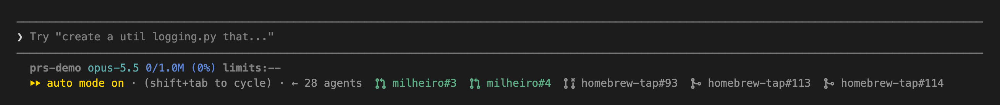

# prs

A Claude Code mod that lists every pull request the session created in the hint line under the prompt. Claude Code itself shows only the latest one (`· PR #12`).



Each PR gets its state's octicon, a Nerd Font glyph: open, draft, merged or closed. Open PRs come first (green; drafts dimmed with the draft icon), then merged and closed ones, dimmed. Each is a link to the PR. Once the session has PRs in more than one repo, each carries its repo name, as above.

Tested with Claude Code **v2.1.287**. Mods need v2.1.287 or later.

## Install

```bash
claude plugin marketplace add mracos/claude-marketplace
claude plugin install prs@mracos
```

## Requirements

- [`gh`](https://cli.github.com), authenticated, for each PR's state. Without it the PRs still show, all as open.
- A [Nerd Font](https://www.nerdfonts.com) (or a terminal that falls back to its symbols, as Ghostty does) for the icons.

## How it works

Claude Code writes a `pr-link` entry to the session transcript for each PR it creates or attaches. The mod reads those, asks `gh pr view` for each one's state when the session starts, after every turn and every two minutes, and stops asking once a PR is merged or closed.

## Tests

```bash
claude plugin test .
```
