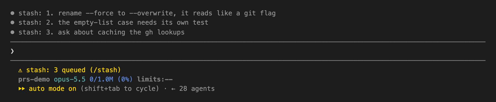

# stash

A Claude Code mod that queues ideas while Claude is working. Type `/stash <idea>` mid-turn and it is saved at once, without interrupting the turn and without Claude ever reading it. Pop it into the prompt box when you are ready.



Tested with Claude Code **v2.1.296**. Mods need v2.1.287 or later.

## Install

```bash
claude plugin marketplace add mracos/claude-marketplace
claude plugin install stash@mracos
```

## Usage

| Command | Does |
|---------|------|
| `/stash <idea>` | Queue an idea |
| `/stash push <idea>` | Same, for an idea that starts with a command word |
| `/stash` or `/stash list` | Show the queue, numbered |
| `/stash pop [N]` | Move item N (default: the newest) into the prompt box |
| `/stash drop [N]` | Remove item N (default: the newest) |
| `/stash clear` | Empty the queue |

`/stash drop the old cache` queues the idea "drop the old cache": a command word followed by anything that is not an item number is an idea.

## How it behaves

- **Runs mid-turn.** The command is registered as immediate, so it runs as soon as you press Enter, even while Claude is working, and never starts a turn.
- **Claude never sees it.** Confirmations are toasts, the list is dim transcript lines (one per idea), and the queue size is a status line under the prompt (`stash: 2 queued (/stash)`). None of these are sent to the model.
- **Sends on its own when Claude is done.** When a turn ends with an answer and no queued prompt starts the next one within a second, the newest idea goes out as your next prompt. That turn's end sends the next one, so the stash drains one idea per turn. It never sends over a draft in the prompt box, an interrupted turn sends nothing, and `claude -p` never sends.
- **`/stash pop` fills, it does not send.** An idea you pop yourself lands in the prompt box for you to edit or send. Where there is no prompt box (`claude -p`), it is printed instead.
- **One queue per session.** Each session keeps its own queue, which survives restarts of that session. `/clear` starts a new session, and with it an empty queue.

## Tests

```bash
claude plugin validate .
claude plugin test
```

Both run offline, with no sign-in. See [docs/integrating.md](docs/integrating.md) for the layout and the constraints behind it.

## License

MIT
